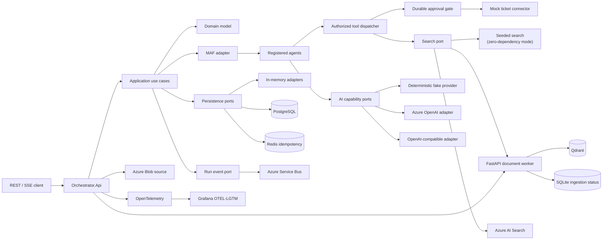
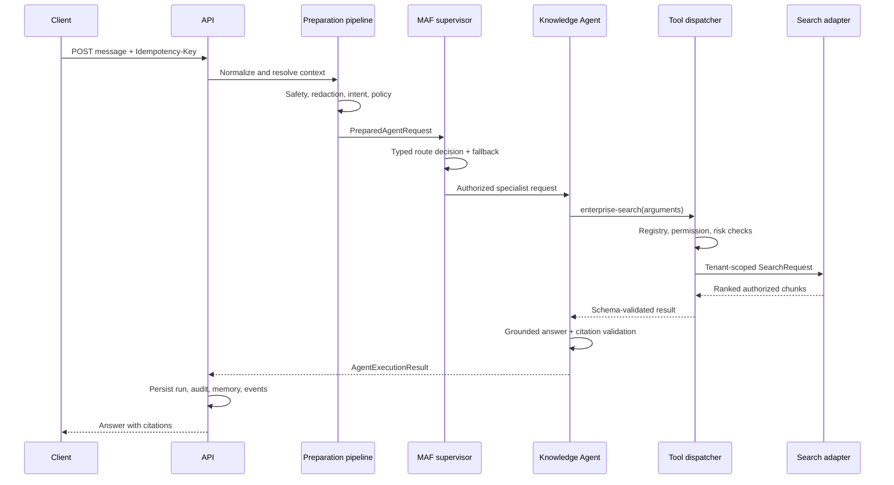
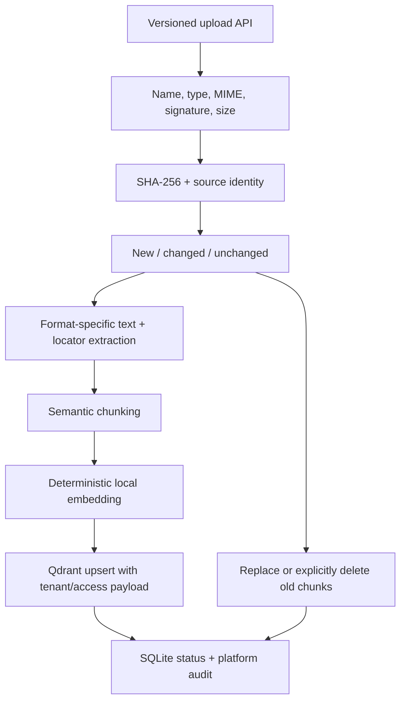
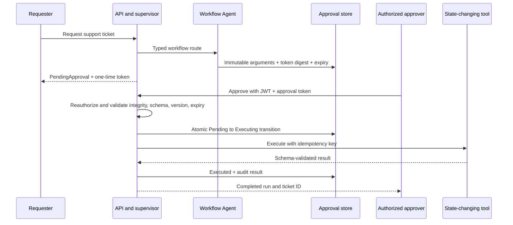

# Enterprise Agent Orchestration Kit

A clean-room, production-oriented reference platform for building secure, observable, provider-independent enterprise agent systems. It starts as a modular monolith, uses Microsoft Agent Framework (MAF) behind a dedicated adapter, and keeps domain and application code independent of AI/search SDKs.

> Project status: the six planned implementation phases are represented by working vertical slices. The zero-cloud profile is deterministic; the Azure profile includes concrete OpenAI, Search, Blob, Service Bus, and Bicep adapters. Cloud deployment still requires the operator's own subscription, model deployments, RBAC review, and cost approval.

## What works today

- Versioned ASP.NET Core REST API on .NET 10 LTS
- Typed preparation pipeline: normalization, safety, redaction, context, intent, policy
- MAF 1.26 typed supervisor with bounded sequential/parallel specialist execution, isolated in `Orchestrator.AgentFramework`
- Registration-based agent and tool catalogs; no central routing switch
- Knowledge, Document Analyst, and Workflow agents with tenant/access filtering and fail-closed citation validation
- Deterministic fake, OpenAI-compatible, and Azure OpenAI chat/structured-output/embedding adapters
- Read-only enterprise search tool with explicit JSON schemas and permissions
- Conversation, compacted context, run cancellation, feedback, idempotency, event, and structured audit persistence ports
- In-memory zero-cloud mode and PostgreSQL adapter
- Redis-backed atomic idempotency with tenant-prefixed keys and readiness checks
- SSE run events, Problem Details errors, correlation IDs, rate limits, and request size limits
- OpenTelemetry traces/metrics/logs to a local Grafana OTEL-LGTM backend
- Unit, integration, architecture, Testcontainers, API evaluation, and full-stack end-to-end gates
- FastAPI document worker with PDF, DOCX, PPTX, XLSX, Markdown, and UTF-8 text extraction
- Deterministic local embeddings, Qdrant indexing, duplicate removal, and tenant/access-tag filtering
- Content-hash incremental ingestion: unchanged sources are skipped, changed sources replace old chunks, and deletion removes indexed chunks
- Azure AI Search hybrid + semantic query adapter using stable REST `2026-04-01`, integrated query vectorization, ACL prefilters, and managed identity
- Azure OpenAI chat, strict structured-output, and embedding adapter with API-key, developer-credential, and managed-identity modes
- Azure AI Search index, Blob data source, chunking/embedding skillset, and scheduled indexer JSON templates
- Azure Blob source adapter, Azure Service Bus event fan-out, and a managed-identity-first Bicep foundation
- JWT bearer authentication with ephemeral local tokens and production OIDC authority/audience mode
- Durable, tenant-isolated human approval with immutable arguments, expiring single-use tokens, and audited execution
- Workflow Agent plus approval-gated synthetic ticket connector
- Versioned EF Core PostgreSQL migrations
- Dependency review, CodeQL, Gitleaks, Dependabot, and container vulnerability scanning workflows

## Architecture



Dependency direction is inward: Domain has no project dependency, Application depends only on Domain, and all external technology is implemented as an adapter. MAF's evolving surface is contained in one project.

### Agent execution



### Document ingestion



### Human approval



## Repository layout

```text
src/
  Orchestrator.Api/             MVC controllers and HTTP composition root
  Orchestrator.Contracts/       Public transport contracts
  Orchestrator.Domain/          Provider-independent domain
  Orchestrator.Application/     Use cases, ports, policies, registries
  Orchestrator.AgentFramework/  MAF isolation adapter
  Orchestrator.Providers/       Deterministic local adapters
  Orchestrator.Infrastructure/  PostgreSQL persistence adapter
  Orchestrator.Observability/   OpenTelemetry configuration
  document-worker/              FastAPI extraction and Qdrant indexing runtime
tests/                          Unit, integration, architecture, E2E
docs/adr/                       Architecture decision records
```

The separate `AgentFramework` project is intentional: it makes experimental/framework-specific changes visible and prevents provider types from leaking inward. The Python worker is a separate process because document libraries require a different runtime; orchestration remains a modular monolith.

## Run locally

Prerequisites: .NET SDK from `global.json`; Docker only for the containerized profile.

Zero-cloud, in-memory mode:

```bash
dotnet restore EnterpriseAgentOrchestrationKit.slnx
dotnet run --project src/Orchestrator.Api/Orchestrator.Api.csproj
```

Full local dependencies, PostgreSQL persistence, Redis idempotency, Qdrant ingestion, and Grafana:

```bash
cp .env.example .env
make up
```

- API: `http://localhost:8080`
- Interactive Swagger UI (development): `http://localhost:8080/swagger`
- OpenAPI document (development): `http://localhost:8080/openapi/v1.json`
- Document worker internal API: `http://localhost:8090/docs`
- Grafana: `http://localhost:3000`
- Liveness/readiness: `/health/live`, `/health/ready`

The compose password is deliberately local-only. Set a non-default value if the stack is reachable by other machines.

Fresh databases apply versioned EF Core migrations automatically. If this repository was run before migrations were introduced, preserve any local data you need and recreate that development database before starting the updated stack; an `EnsureCreated` database has no migration history.

## Try the vertical slice

The default development profile uses a short-lived JWT signed by an ephemeral startup key. Swagger obtains this token automatically, so the demo tenant/user fields do not need to be entered for every request. The development issuer is not a production identity system; outside Development the API refuses to start unless `Authentication:Mode=Oidc` and an authority/audience are configured. Swagger and OpenAPI UI endpoints are disabled outside Development.

For command-line calls, create a token once (the examples below use `jq` only to extract the JSON field):

```bash
TOKEN=$(curl -sS -X POST http://localhost:8080/api/v1/auth/development-token \
  -H 'Content-Type: application/json' \
  -d '{"tenantId":"demo-tenant","userId":"demo-user","permissions":["knowledge.read","documents.write","tickets.write","approvals.approve"],"accessTags":["employee"]}' \
  | jq -r '.accessToken')
```

First upload a synthetic document (or use Swagger `POST /api/v1/documents`):

```bash
curl -sS -X POST http://localhost:8080/api/v1/documents \
  -H "Authorization: Bearer $TOKEN" \
  -F 'file=@samples/contoso-operations-assistant/travel-policy.md;type=text/markdown' \
  -F 'accessTags=employee' \
  -F 'sourceUri=demo://uploads/travel-policy'
```

Then create a conversation:

```bash
curl -sS -X POST http://localhost:8080/api/v1/conversations \
  -H 'Content-Type: application/json' \
  -H "Authorization: Bearer $TOKEN" \
  -d '{"title":"Travel policy"}'
```

Use the returned conversation ID:

```bash
curl -sS -X POST http://localhost:8080/api/v1/conversations/CONVERSATION_ID/messages \
  -H 'Content-Type: application/json' \
  -H 'Idempotency-Key: demo-question-1' \
  -H "Authorization: Bearer $TOKEN" \
  -d '{"message":"What is the international travel daily expense limit?"}'
```

The expected `85 units` fact and all other demo answers are synthetic sample content, not real organizational guidance. Their source is versioned under `samples/contoso-operations-assistant/` so extraction, retrieval, and citations can be reviewed independently. Uploading the same `sourceUri` and content again returns `Skipped`; uploading changed content replaces its previous Qdrant points.

Reusing the same idempotency key for the same tenant/user returns the recorded run. Stream recorded run events with `GET /api/v1/runs/{runId}/events`.

Runs can be queried, cancelled while non-terminal, and rated through `GET /api/v1/runs/{runId}`, `POST /api/v1/runs/{runId}/cancel`, and `POST /api/v1/runs/{runId}/feedback`. Feedback is tenant/user scoped and only one item is accepted per completed run.

To test human approval, send `{"message":"Create a support ticket for a broken demo laptop."}` to the same messages endpoint with a new idempotency key. The response is `PendingApproval` and contains a one-time `approval.approvalToken`. No ticket has been created at this point. Execute the immutable proposal with:

```bash
curl -sS -X POST http://localhost:8080/api/v1/approvals/APPROVAL_ID/approve \
  -H 'Content-Type: application/json' \
  -H "Authorization: Bearer $TOKEN" \
  -d '{"approvalToken":"APPROVAL_TOKEN"}'
```

The mock connector returns a deterministic `TKT-...` identifier. A second approval attempt is rejected and cannot create another ticket. The full ready-to-run sequence is also in `src/Orchestrator.Api/Orchestrator.Api.http`.

## Extension guides

### Add an agent

Implement `IAgentDefinition`, publish an immutable `AgentDescriptor`, and register the implementation with dependency injection. The `AgentRegistry` discovers it automatically. Keep model calls behind capability ports and return a typed `AgentExecutionResult`. Add routing and authorization tests; do not add a central `switch`.

### Add a tool

Implement `IAgentTool` with name, semantic version, input/output JSON schemas, required permissions, risk, timeout, retry, mutation, and idempotency metadata. Register it with DI. The dispatcher rejects unknown and unauthorized names. State-changing tools must remain approval-gated and validate arguments again after approval.

### Add an AI provider

Implement only the required capability ports (`IChatCompletionProvider`, `IStructuredCompletionProvider`, `IEmbeddingProvider`, `IRerankingProvider`, `ISafetyProvider`, `ITokenCounter`). Translate provider DTOs inside the adapter. Apply bounded timeout/retry/circuit-breaker policies there and add contract tests against the deterministic provider behavior.

The included `OpenAiCompatibleProvider` demonstrates the same ports over standard `/chat/completions` and `/embeddings` endpoints. This supports compatible local gateways without coupling application code to their SDKs.

## Security model and limits

Controls already demonstrated include JWT validation, fail-closed registries, tool permissions, tenant and access-tag filters, prompt-injection heuristics, secret redaction, request limits, structured errors, correlation IDs, idempotency, approval integrity checks, and non-root/read-only API containers. Full prompts, approval tokens, and document bodies are not added as telemetry attributes.

Known limits of the current phase:

- Development tokens and test headers are synthetic facilities, not production identity systems. OIDC configuration still requires an external provider and deployment-specific claim mapping review.
- Prompt-injection detection is heuristic and cannot prove content safe.
- PostgreSQL tenant filtering is enforced in repository queries, not database row-level security yet.
- Local retrieval currently uses deterministic vector search. Azure AI Search supports native hybrid and semantic retrieval; application-side local hybrid fusion remains future work.
- Retrieval grounding thresholds are configurable and provider-specific. A fail-closed lexical evidence-overlap gate also rejects vector matches with no meaningful query/evidence term in common. The included defaults reduce weak matches on the synthetic dataset, but they are not a universal relevance guarantee; tune and re-evaluate them for each corpus and language.
- The included ticket connector is deliberately synthetic. Real connectors still require connector-side authorization, idempotency, and reconciliation.
- Approval expiry is enforced when records are accessed; scheduled cleanup is not implemented yet.
- Upload validation checks names, extensions, MIME, basic signatures, size, tenant, and access tags. It does not replace malware scanning or content-disarm/reconstruction.
- Office/PDF parsing runs in the non-root, read-only worker container but is not a hardened untrusted-file sandbox. Production deployments should add isolation and scanning.
- Ingestion status uses worker-local SQLite; horizontal workers require a shared durable job store in a later phase.
- Synchronous message execution means cancellation is most useful for a run waiting on human approval. A production queue-backed asynchronous run-start endpoint would be needed for robust interruption of long provider calls.
- The Service Bus adapter durably publishes run events while SSE replay remains process-local. Cross-instance replay requires a dedicated event store or session-aware consumer design.

See [SECURITY.md](SECURITY.md) before adapting the project for production.

## Tests

```bash
dotnet build EnterpriseAgentOrchestrationKit.slnx
dotnet test EnterpriseAgentOrchestrationKit.slnx --no-build
dotnet format EnterpriseAgentOrchestrationKit.slnx --verify-no-changes --no-restore
docker build --target test -t enterprise-agent-kit-document-worker-tests src/document-worker
docker run --rm enterprise-agent-kit-document-worker-tests
TESTCONTAINERS_ENABLED=true dotnet test tests/Orchestrator.IntegrationTests/Orchestrator.IntegrationTests.csproj
docker compose up --detach --build --wait
bash tests/e2e/full-stack.sh
docker compose down --volumes
```

Most tests use deterministic in-process adapters and require no paid model. The opt-in Testcontainers suite applies all migrations to a clean PostgreSQL 17 instance, verifies tenant-scoped persistence, and proves Redis idempotency is atomic and tenant-prefixed. The full-stack gate exercises upload, Qdrant ingestion, grounded answer, cross-tenant isolation, approval, and replay protection over real HTTP.

The 30-case versioned evaluation smoke dataset covers routing, tool selection, groundedness, exact citation sets, no-answer behavior, prompt-injection resistance, latency, token proxies, and fake-provider cost. No-answer cases must return no citations. Against the Qdrant-backed stack it uploads its own synthetic seed documents first. Start the deterministic API and run `python3 evaluations/run.py`; CI applies the thresholds in `evaluations/thresholds.json`. A protected, manually dispatched workflow exercises real providers and reports uncollected cost as `null`, never as zero. No unmeasured benchmark claim is made.

## Azure deployment approach

The cloud profile maps ports to Azure OpenAI, Azure AI Search, Blob Storage, and Service Bus. `deploy/azure/main.bicep` provisions a cost-conscious managed-services foundation and least-privilege identity assignments; it deliberately does not create long-running application compute or databases without an explicit operator decision. Use `az deployment group what-if` before deployment. No Azure resource is required by the default demo. See [Azure deployment](deploy/azure/README.md), [Azure OpenAI adapter](docs/azure-openai.md), and [Azure AI Search adapter](docs/azure-ai-search.md).

## Roadmap

- [x] Phase 1: clean-room discovery, target architecture, ADRs, repository foundation
- [x] Phase 2: tested conversation-to-grounded-answer vertical slice
- [x] Phase 3: Python document worker, multi-format extraction, Qdrant ingestion and incremental sync
- [x] Phase 4: OIDC/JWT, stronger tenant controls, durable approval workflow
- [x] Phase 5: Azure AI/search/storage/messaging adapters and deployment templates
- [x] Phase 6: versioned evaluation datasets, regression gates, expanded documentation

Performance or security benchmarks are not claimed until measured and published with their datasets and environments.

## License

MIT. See [LICENSE](LICENSE).
